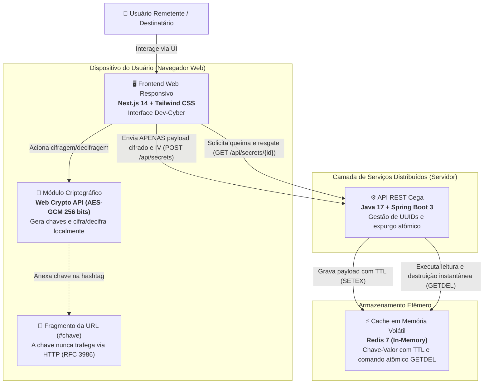
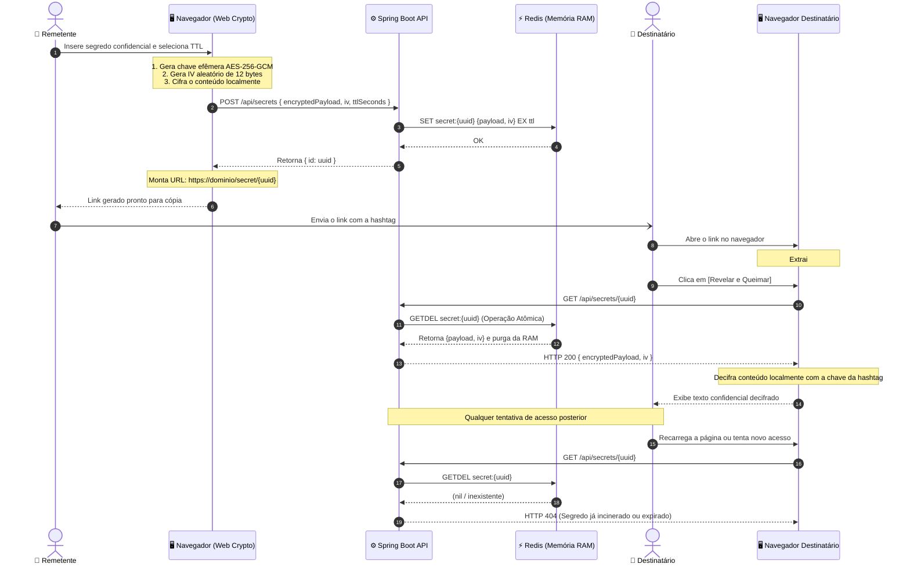
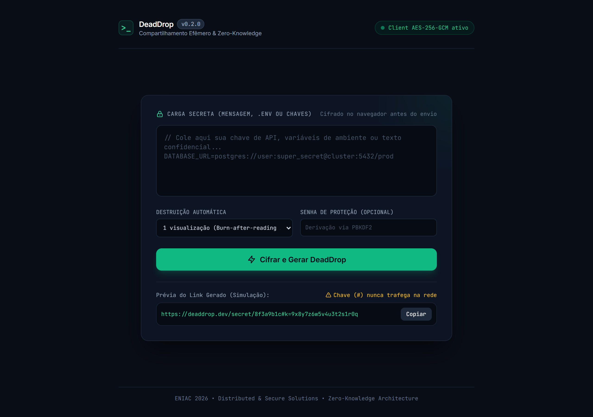

# 🔐 DeadDrop

> **Plataforma Distribuída de Compartilhamento Seguro e Efêmero de Informações Sensíveis baseada em Arquitetura Zero-Knowledge e Burn-After-Reading.**

[](https://openjdk.org/)
[](https://spring.io/projects/spring-boot)
[](https://nextjs.org/)
[](https://www.typescriptlang.org/)
[](https://redis.io/)
[](https://developer.mozilla.org/en-US/docs/Web/API/Web_Crypto_API)

---

## 📌 Visão Geral do Projeto

No ambiente corporativo e em equipes de engenharia de software, é frequente a necessidade de compartilhar credenciais temporárias, chaves de API, variáveis de ambiente (`.env`) ou certificados digitais. Frequentemente, esses dados são enviados por canais persistentes (Slack, Microsoft Teams, WhatsApp ou e-mail), onde permanecem indelevelmente registrados no histórico, vulneráveis a vazamentos e em desacordo com a **LGPD** (_Lei Geral de Proteção de Dados_).

O **DeadDrop** foi desenvolvido para solucionar esse problema através de uma abordagem minimalista e matematicamente segura:

- **Zero-Knowledge (Servidor Cego):** O dado é cifrado no navegador do remetente com **AES-GCM de 256 bits** antes de qualquer transmissão. O servidor nunca tem acesso ao texto limpo e nem à chave de decifragem.
- **Isolamento de Chaves pela RFC 3986:** A chave simétrica é inserida exclusivamente no fragmento da URL (`https://.../secret/{uuid}#chave`). Conforme a especificação padrão da web, navegadores **nunca** transmitem o fragmento `#` nas requisições HTTP.
- **Queima Atômica (_Burn-After-Reading_):** O dado reside exclusivamente na memória volátil (RAM) do Redis. Ao ser resgatado uma única vez pelo destinatário, a API executa a instrução atômica `GETDEL`, eliminando o segredo instantaneamente da memória sem deixar rastros em disco.
- **Expurgo por TTL Ativo:** Segredos não lidos são automaticamente incinerados pelo próprio motor do Redis após o período estipulado (1 hora, 24 horas ou 7 dias).

---

## 🏗️ Arquitetura do Sistema

O projeto adota o princípio **KISS (Keep It Simple, Stupid)**, dividindo-se em 3 componentes desacoplados:



---

## 🔄 Fluxo de Cifragem, Transporte e Incineração

O diagrama de sequência a seguir detalha o ciclo de vida completo de um segredo compartilhado:



---

## 🎨 Identidade Visual (Dev-Cyber Minimalista)



O frontend foi desenvolvido sob a estética **Dev-Cyber**, projetada para desenvolvedores e profissionais de cibersegurança:

- **Dark Mode Elegante:** Tons de ardósia e carvão escuro (`#090D16`, `#0F172A`) com bordas sutis.
- **Tipografia Técnica:** Combinação de _Inter_ para elementos de navegação e _JetBrains Mono_ para variáveis, códigos e áreas de texto.
- **Feedback Visual em Tempo Real:** Indicador de segurança ativa, aviso de não-tráfego de chave na rede e contador de queima atômica.

---

## 📁 Estrutura de Diretórios

```text
├── backend/                       # API REST em Java 17 + Spring Boot 3
│   ├── src/main/java/             # Código-fonte da aplicação
│   │   └── com/eniac/deaddrop/
│   │       ├── controller/        # SecretController (endpoints POST e GET)
│   │       ├── dto/               # Records imutáveis de entrada/saída
│   │       └── service/           # SecretService com integração atômica Redis (GETDEL)
│   ├── src/test/java/             # Testes automatizados (JUnit 5 + Mockito)
│   └── pom.xml                    # Configuração Maven do projeto
│
├── frontend/                      # Aplicação Web em Next.js 14 + Tailwind CSS
│   ├── src/app/                   # App Router do Next.js
│   │   ├── page.tsx               # Tela principal de criação de DeadDrop
│   │   └── secret/[id]/page.tsx   # Tela de revelação, queima e decifragem local
│   ├── src/lib/                   # Módulos de lógica
│   │   ├── crypto.ts              # Motor criptográfico Web Crypto API (AES-256-GCM)
│   │   └── crypto.test.mjs        # Testes de integridade da criptografia no cliente
│   └── package.json               # Dependências do frontend
│
├── docs/                          # Documentação e diagramas
│   └── diagrams/                  # Diagramas C4 e de Sequência em Mermaid
│
├── docker-compose.yml             # Orquestração do serviço Redis 7 em memória
├── .env.example                   # Exemplo de variáveis de ambiente
└── README.md                      # Documentação completa do projeto
```

---

## 🚀 Como Executar o Projeto Localmente

### Pré-requisitos

- **Java Development Kit (JDK):** Versão 17 ou superior.
- **Node.js:** Versão 18 ou superior.
- **Docker & Docker Compose** (ou um servidor Redis local rodando na porta 6379).

---

### Passo 1: Iniciar o Armazenamento Efêmero (Redis)

Suba a instância volátil do Redis via Docker Compose:

```bash
docker compose up -d redis
```

_(Caso não possua Docker, basta ter um servidor Redis ativo em `localhost:6379`)_.

---

### Passo 2: Executar o Backend (Spring Boot)

Abra o diretório `backend` no **IntelliJ IDEA** (ou via terminal) e execute:

```bash
cd backend
mvn spring-boot:run
```

A API REST estará disponível em: `http://localhost:8080`

- `POST http://localhost:8080/api/secrets`
- `GET  http://localhost:8080/api/secrets/{id}`

---

### Passo 3: Executar o Frontend (Next.js)

Abra um novo terminal no diretório `frontend`:

```bash
cd frontend
npm install
npm run dev
```

Acesse a aplicação no navegador em: **`http://localhost:3000`**

---

## 🧪 Executando os Testes Automatizados

### Testes do Backend (JUnit 5 + Mockito)

Para rodar a suíte de testes de controller, service e queima atômica:

```bash
cd backend
mvn test
```

> Resultado esperado: **6/6 testes aprovados (`BUILD SUCCESS`)**, cobrindo criação com TTL, queima atômica via `GETDEL` e rejeição em segunda leitura (404 Not Found).

### Testes do Frontend (Web Crypto API)

Para validar a conformidade da cifragem e decifragem AES-256-GCM local:

```bash
cd frontend
npm test
```

> Resultado esperado: **2/2 testes aprovados**, garantindo roundtrip de dados sensíveis e rejeição de adulterações de bytes via authentication tag.

---

## 🎓 Contexto Acadêmico

Este projeto é desenvolvido como parte integrante do **Módulo 6** do curso de **Engenharia de Software** do **Centro Universitário ENIAC**.

- **Disciplina:** Projeto Integrador — _Distributed and Secure Solutions_
- **Professor Avaliador:** Prof. Lucio Luzetti Criado
- **Aluno:** Nicholas Santos Pereira — RA: `269722025`
- **Semestre:** 2º Semestre / 2026

---

## 📄 Licença

Distribuído sob a licença **MIT**. Consulte `LICENSE` para mais informações.
